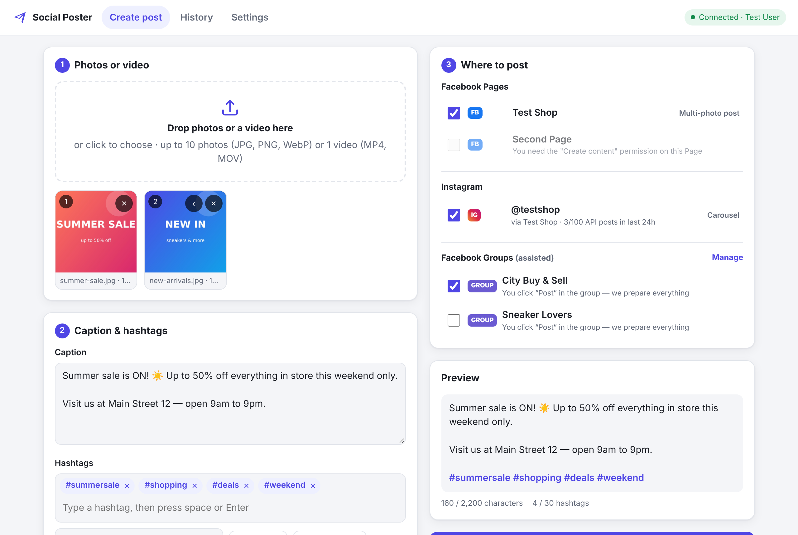

# Social Poster

Post your **photos and videos** to **Facebook Pages**, **Instagram (feed posts & Reels)** and
**Facebook Groups** from one screen. You add the media, type your **caption** and **hashtags**,
tick where it should go and press **Post now**.

| Where | Photos | Videos | How |
| --- | --- | --- | --- |
| Facebook Page | Photo post, or multi-photo post (up to 10) | **Reel** or regular video post | Fully automatic (official Meta API) |
| Instagram (business/creator account) | Feed post, or carousel (up to 10) | **Reel** | Fully automatic (official Meta API) |
| Facebook Group | ✔ | ✔ | **Assisted** — the app copies the text, prepares the photo/video and opens the group; you press *Post* (see [why](#facebook-groups)) |

What it does for you:

- Caption + hashtag box with chips, saved **hashtag sets**, live preview and Instagram limit counters
  (2,200 characters, 30 hashtags, 20 @mentions).
- Fixes media automatically: converts photos to the JPEG Instagram needs, adds soft blurred borders to
  photos that are too tall/wide for Instagram (instead of cropping them), and — if `ffmpeg` is
  installed — converts videos that Instagram/Reels would reject.
- Live progress for every destination, links to the published posts, plain-language error messages,
  “Retry failed”, and a **history** of everything you posted (“Use again” reloads a post).
- Works on your computer (nothing to host) or online behind a password; usable from a phone browser.



---

## 1. Install and start

You need **Node.js 20.12 or newer** (the LTS version from <https://nodejs.org> is fine).
`ffmpeg` is optional but recommended for videos ([install ffmpeg](#videos-and-ffmpeg)).

```bash
npm install
cp .env.example .env        # Windows: copy .env.example .env
npm start
```

Open **<http://localhost:3000>**. The app runs on your computer only; nobody else can reach it.

## 2. Create your Meta app (one time, ~10 minutes)

Meta only lets apps post through its official API, so you need your own (free) “app”.
You do **not** need App Review: as the app’s admin you can always post to your own Pages and Instagram accounts.

**Before you start**

- You must be an admin of the **Facebook Page** you want to post to.
- For Instagram: the account must be a **professional account** (Business or Creator) and be
  **linked to that Facebook Page** (Instagram app → *Settings → Account type and tools*; then on Facebook:
  *Page settings → Linked accounts → Instagram → Connect*).

**Create the app**

1. Go to <https://developers.facebook.com/apps> and click **Create app** (log in with the Facebook
   account that manages your Page; accept the developer terms if asked).
2. Give it a name (e.g. “My Poster”). When asked what the app should do, pick the use cases
   **“Manage everything on your Page”** and **“Manage messaging & content on Instagram”**
   (in older versions of this screen: choose **Other**, then app type **Business**).
3. Finish the wizard. In the app dashboard make sure these permissions are added/enabled for your use cases:
   `pages_show_list`, `pages_read_engagement`, `pages_manage_posts`, `instagram_basic`,
   `instagram_content_publish`, `business_management`.
4. Open **App settings → Basic**, copy the **App ID** and **App secret** into your `.env` file:

   ```ini
   META_APP_ID=1234567890
   META_APP_SECRET=abc123...
   ```

5. Restart the app (`Ctrl+C`, then `npm start`).

**Connect your accounts**

In the app open **Settings → Connect with Facebook**, log in, and when Facebook asks, **select your
Pages and Instagram accounts** and allow every permission. Your Pages and linked Instagram accounts now
appear under “Where to post”.

> **Alternative (no login button):** open the [Graph API Explorer](https://developers.facebook.com/tools/explorer/),
> choose your app, add the permissions listed above, click *Generate Access Token*, then paste the token in
> **Settings → Or paste an access token**. With `META_APP_ID`/`META_APP_SECRET` set it is extended to ~60 days
> automatically, and the Page tokens derived from it do not expire.

## 3. Instagram photos: give Instagram a way to download them

Instagram’s API **downloads photos from a public web address** — it cannot receive a photo directly from
your computer. (Reels and all Facebook posts are uploaded directly and need nothing extra.)
Pick one option:

| Option | Best for | What to do |
| --- | --- | --- |
| **imgbb (easiest)** | Running on your own computer | Get a free key at <https://api.imgbb.com/> and set `IMGBB_API_KEY=` in `.env`. Each photo is uploaded there just for Instagram to fetch and deleted automatically after one hour. |
| **Put the app online** | Using it from anywhere (phone too) | Deploy it ([see below](#run-it-online)). `PUBLIC_BASE_URL` is detected on Render/Railway/Fly.io; set it yourself elsewhere. |
| **Tunnel** | Testing | Run `cloudflared tunnel --url http://localhost:3000` (or ngrok), then set `PUBLIC_BASE_URL=https://…` and `APP_PASSWORD=` and restart. |

Until one of these is set, Instagram *photo* posts are disabled in the app (with an explanation); everything else works.

## 4. Posting

1. **Create post** tab → drop up to **10 photos** *or* **1 video** into the box.
2. Write the **caption**. Type **hashtags** in the hashtag box (space, comma or Enter adds one; `#` is optional).
   Use **Save as set** to reuse groups of hashtags. The final text is your caption, a blank line, then the hashtags.
3. Tick where to post. For videos on a Facebook Page choose **Reel** (vertical, 3–90 s — chosen automatically
   when it fits) or **Video post**. Instagram videos are always posted as **Reels**.
4. Press **Post now** and watch each destination finish. Use **View ↗** to open the published post.

### Facebook Groups

**Meta removed the Facebook Groups API in April 2024** (the `publish_to_groups` permission no longer exists),
so no app — including this one — can post in groups automatically anymore. Tools that still claim to do it
drive your browser like a robot, which breaks Facebook’s terms and regularly gets accounts restricted.

Social Poster makes the manual part as fast as possible instead:

1. Save your groups once in **Settings → Facebook Groups** (name + group link).
2. Tick the groups when you post. After the automatic posts finish, each group gets a checklist:
   **Copy text** → **Copy photo** (or **Download**) → **Open group ↗** → paste → *Post* → **Mark as posted**.
3. History remembers which groups you have finished.

Tip: you can also open the published Page post and use Facebook’s **Share → Group** button.

## Limits worth knowing

| | Limit |
| --- | --- |
| Instagram caption | 2,200 characters, 30 hashtags, 20 @mentions |
| Instagram photos | JPEG, 4:5 to 1.91:1 (the app converts/pads automatically), max 8 MB |
| Instagram carousel | 2–10 photos; all are shown in the shape of the first one |
| Instagram Reels | 3 s – 15 min, MP4/MOV (H.264/HEVC + AAC), max 300 MB |
| Instagram API posts | about 100 per account per 24 h (shown next to each account) |
| Facebook Reels | 3–90 s, at least 540×960, vertical recommended; about 30 API Reels per Page per 24 h |
| Uploads in this app | 1 GB per file by default (`MAX_UPLOAD_MB`); files are deleted after 7 days (`MEDIA_RETENTION_DAYS`) |

## Videos and ffmpeg

Instagram is picky about video files (codec, frame rate, the “fast start” index position…). With
[ffmpeg](https://ffmpeg.org) installed the app checks every video and, only when needed, makes a compatible
copy (H.264/AAC MP4, ≤1920 px wide, 24–60 fps, fast start). Without ffmpeg videos are sent as they are and
the app warns you when Instagram is likely to reject one.

- Windows: `winget install ffmpeg` · macOS: `brew install ffmpeg` · Ubuntu/Debian: `sudo apt install ffmpeg`
- Restart the app afterwards; **Settings → App status** shows whether it was found.

## Run it online

The app can run on any server or platform that runs Node.js or Docker. When it is reachable from the internet
it **refuses to start without `APP_PASSWORD`**, and asks for that password in the browser.

**Docker**

```bash
docker build -t social-poster .
docker run -d --name social-poster -p 3000:3000 -v social-poster-data:/data \
  -e APP_PASSWORD='choose-a-long-password' \
  -e META_APP_ID=... -e META_APP_SECRET=... \
  -e PUBLIC_BASE_URL=https://poster.example.com \
  social-poster
```

Put it behind HTTPS (e.g. Caddy, nginx, or your platform’s built-in HTTPS). Keep `/data` on a persistent
volume — it holds your connection, history and uploads.

**Render / Railway / Fly.io**: create a web service from this repository (start command `npm start`, or use
the Dockerfile), add the environment variables above, and attach a persistent disk at `/data` with
`DATA_DIR=/data`. `PUBLIC_BASE_URL` is filled in automatically on these platforms.

After deploying, add `https://<your-address>/auth/facebook/callback` to your Meta app under
**Facebook Login → Settings → Valid OAuth Redirect URIs** (not needed for `localhost`).

## Settings reference (`.env`)

| Variable | Default | Purpose |
| --- | --- | --- |
| `META_APP_ID`, `META_APP_SECRET` | — | Your Meta app. Enables “Connect with Facebook” and 60-day tokens. |
| `META_LOGIN_CONFIG_ID` | — | Facebook Login for Business configuration ID (use instead of the permission list). |
| `META_SCOPES` | see `src/config.js` | Comma-separated permissions requested at login. |
| `META_GRAPH_VERSION` | `v27.0` | Meta Graph API version. |
| `IMGBB_API_KEY` | — | Temporary public links for Instagram photos (local use). |
| `PUBLIC_BASE_URL` | auto on Render/Railway/Fly | Public https address of this app. Requires `APP_PASSWORD`. |
| `APP_PASSWORD` | — | Password for the web interface. Required when reachable from other computers. |
| `PORT`, `HOST` | `3000`, `127.0.0.1` | Where the app listens. Use `HOST=0.0.0.0` on servers/Docker. |
| `DATA_DIR` | `./data` | Connection tokens, history, uploads. **Keep it private.** |
| `MAX_UPLOAD_MB`, `MEDIA_RETENTION_DAYS` | `1024`, `7` | Upload limit and how long uploads are kept. |
| `FFMPEG_PATH`, `FFPROBE_PATH` | `ffmpeg`, `ffprobe` | Location of ffmpeg if it is not on your PATH. |
| `META_APPSECRET_PROOF` | `false` | Send `appsecret_proof` (turn on if your app has “Require App Secret” enabled). |
| `DEBUG` | `false` | Log every Meta API request (tokens are never logged). |

## Troubleshooting

| Message / problem | What to do |
| --- | --- |
| *“No Facebook Pages were found”* | Connect again and, in Facebook’s popup, click **Edit access/Edit settings** and select your Pages and Instagram accounts. You must be a Page admin. |
| Instagram account missing | It must be a Business/Creator account **linked to the Page**, then **Settings → Refresh accounts**. |
| Login popup shows *“Invalid Scopes”* or a configuration error | Add the missing permissions to your app’s use cases (step 2.3), or create a *Facebook Login for Business* configuration (User access token + the permissions above) and set `META_LOGIN_CONFIG_ID`. |
| *“URL blocked”* during login | Add the redirect URL shown in **Settings** to *Facebook Login → Settings → Valid OAuth Redirect URIs*. |
| *“Instagram could not download the photo”* | Your `PUBLIC_BASE_URL` is not reachable from the internet (or use `IMGBB_API_KEY`). |
| *“Your Facebook connection expired”* | Connect again in Settings (happens after a password change or when the 60-day login runs out). |
| Instagram rejects a video | Install ffmpeg (see above) or export as MP4, H.264 + AAC, 30 fps, “web optimized”. |
| *“…daily limit…”* | Meta’s per-account publishing limits — try again tomorrow. |

## Privacy & security

- Access tokens are stored only in `data/store.json` on the machine running the app and are never sent to the browser.
- Uploaded files stay in `data/uploads/` and are deleted after `MEDIA_RETENTION_DAYS`. Only the prepared
  Instagram copies are publicly downloadable (at unguessable addresses) so that Instagram can fetch them.
- Running locally the app only accepts requests from your own computer and blocks requests made by other websites.

## For developers

```bash
npm test          # unit tests + end-to-end tests against a fake Meta API (ffmpeg needed for video tests)
DEBUG=true npm start
```

- `src/meta/` — Graph API client, account discovery, Facebook & Instagram publishers, error messages
- `src/media.js` — upload handling, photo conversion/padding (sharp), video checks/conversion (ffmpeg)
- `src/jobs.js` — runs a post across all destinations and tracks progress/history
- `src/routes/api.js` — HTTP API · `public/` — the web interface (no build step) · `public/shared/` — rules used by both
- `test/helpers/mockMeta.js` — fake Graph API, rupload and imgbb servers used by the tests

Meta API references: [Pages API posts](https://developers.facebook.com/docs/pages-api/posts),
[Reels publishing](https://developers.facebook.com/docs/video-api/guides/reels-publishing),
[Instagram content publishing](https://developers.facebook.com/docs/instagram-platform/content-publishing),
[Instagram resumable uploads](https://developers.facebook.com/docs/instagram-platform/content-publishing/resumable-uploads).
